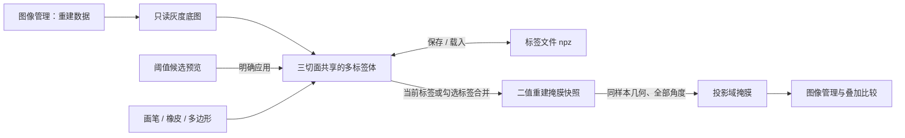

# 标签勾画工作台

把原来右侧的「重建处理」升级为独立的 `LabelingWidget`，形成“选择重建 → 勾画标签 → 检查修改 → 生成投影 → 叠加比较”的完整流程。当前版本已实现本文所列基础功能。

参考 [ITK-SNAP 手工分割教程](https://www.itksnap.org/docs/viewtutorial.php?chapter=TutorialSectionManualSegmentation) 的标签体、三正交切面和接受轮廓交互，以及 [画笔教程](https://itk-snap.sourceforge.net/pmwiki/pmwiki.php?n=Documentation.TutorialSectionNewVersionTwo) 的局部涂画与擦除思路。使用现有 PySide6 与投影内核实现，不引入 ITK 运行依赖。

## 布局

上方与「数据审查」「投影域重建」并列增加「标签勾画」页面。左侧依次管理数据、标签和工具，右侧用 XY、XZ、YZ 三个切面编辑同一份标签体，第四格显示操作提示、未保存状态与当前体素原始值。窗宽窗位在视图区上方独立设置。

左下的保存、输出范围、生成按钮与任务状态固定显示。左上工具区可滚动，手工工具与阈值辅助使用标签页切换。定位、画笔、橡皮、多边形平铺为互斥按钮，覆盖规则使用单选按钮。标签表按实际行数紧凑显示，默认仅一行金属。缩小窗口时仍能直接找到生成入口。

## 标签规则

| 项目 | 设计 |
| --- | --- |
| 标签体 | 与原重建数组一一对应的 `uint16[N,Y,X]`；0 为背景，一个体素属于一个标签 |
| 标签管理 | ID、名称、颜色、可见、锁定、是否参与合并输出；点击标签行设为当前标签 |
| 默认标签 | 仅标签 1，金属，红色；有需要时点击「+ 标签」添加其他结构 |
| 默认覆盖 | 只修改背景与当前标签，保护其他结构 |
| 可选覆盖 | 覆盖所有未锁定标签 |
| 橡皮 | 仅清除当前标签，不误擦其他标签；锁定标签禁止修改 |
| 显示 | 标签不透明度和可见性独立于灰度调窗；隐藏标签仍可输出 |
| 来源 | 灰度原图只读；二值重建数据可直接打开，已有前景初始化为标签 1 |

## 勾画交互

| 工具 | 操作 | 提交方式 |
| --- | --- | --- |
| 定位 | 点击改变另外两个切面的坐标；显示原始值与标签 ID | 不修改标签 |
| 画笔 | 左键连续涂画；连接鼠标采样点，快速移动不留断点；右键擦除当前标签 | 松开鼠标，一笔一个撤销单元 |
| 橡皮 | 当前切面擦除当前标签 | 松开鼠标提交 |
| 多边形 | 左键添加顶点；靠近已有顶点拖动修改；Backspace 删除末点 | 点首点 / 双击 / 右键 / 主键盘或数字键盘 Enter / 闭合按钮填充轮廓 |
| 复用轮廓 | 切层后 Ctrl+V 粘贴本方向上次接受的轮廓，可继续拖动顶点 | 再次接受才写入 |
| 放弃 | Esc 或放弃按钮取消未接受轮廓、未完成笔画；切层与工具切换也先取消未完成操作 | 已提交的标签保留 |

每个幕布下方常备切片滑块，与该幕布的坐标输入框、滚轮和定位点同步；滑块按实际切片位置移动，兼容不连续层号。隐藏用于平移的横向和纵向滚动条，保留中键拖动平移与 Ctrl+滚轮缩放。定位工具下右键拖动调窗。`1/2/3/4` 切换定位、画笔、橡皮、多边形；`Ctrl+Z/Ctrl+Y` 撤销重做。笔画、轮廓、整组阈值分别构成独立的撤销单元，最多保留最近 100 次体素编辑。

画笔为二维圆形，直径以当前切面的像素计；三个视图中的编辑都落到同一个原始体素网格。N 方向保留真实层号，通过位置索引访问体素；切片不连续时，界面选择已有真实层号，投影要求补齐几何范围内的全部切片。

## 阈值是辅助工具

阈值按原始灰度值执行 `≥ / ≤`，非有限值不进入候选。黄色只表示预览，既不改标签，也不参与生成投影。

「应用当前切面」在最后操作的视图中写入当前标签；「应用整组」处理全部原始切片。两者均遵守覆盖和锁定规则，只填入候选，不清除候选外已勾画的标签。需要整体重做时先撤销上次应用。后台操作期间锁定编辑；取消或异常会回滚整个阈值命令，避免只改一半体积。

## 保存与生成

标签文件使用 `.npz`，包含标签体、真实层号、来源路径、名称、颜色、可见、锁定和合并勾选。载入前校验来源、形状、层号和标签值；采用临时文件写完再替换的保存方式。源图不嵌入标签文件，重新打开原重建后可载入继续编辑。

切换页面或数据源保留会话内的标签。关闭程序、点击一键清空、移除有未保存标签的数据时，提示保存或明确放弃。图像管理中的掩膜结果为会话暂存，与保存的标签文件有不同生命周期。

输出方式按用户选择提供两种：

- **当前标签**：只把当前 ID 转成前景。
- **勾选标签合并**：把标签表「输出」列中勾选的 ID 合并成前景；不根据颜色或显示状态推断。

两者均输出 `uint8` 的 `0/1`。可以先加入图像管理为重建掩膜，也可以直接生成全角度投影。每个输出都是一次明确版本的快照，名称带版本号；继续勾画不修改旧结果。

投影复用现有逐射线二值投影。必须具备同样本的 XML/PTM/INI 或有效的继承物理网格，并覆盖全部真实重建层号。继续沿用 Fussen 原生坐标校准，保留真实投影编号、探测器尺寸和角度数量。几何不足时仍允许勾画、保存和导出重建掩膜，禁用生成投影并说明原因。

生成后的投影出现在图像管理和投影叠加下拉框，可与原始投影、已有掩膜进行彩色填充、轮廓或差异比较。

## 模块边界与性能

`labeling_widget.py` 负责界面、鼠标手势和任务调度；`labeling_core.py` 负责标签体、保护规则、差分命令、文件与导出。主窗口只提供图像管理、页面入口、数据变更通知和结果接收，不再包含「重建处理」表单与工作流。

加载时按切片读取原始数据，以真实 dtype 建立临时磁盘映射；标签使用另一份磁盘映射。撤销只记录改变体素的旧值与新值，分切面写入临时文件，避免每次笔画复制整个三维体积。加载、阈值、保存、载入和生成在后台运行，编辑期间与后台写入互斥。取消、删除数据和清空使迟到结果失效；后台任务保有独立资源直到退出。

## 当前边界与后续方向

本版是手工体素标签工作台，按原始数组 N/Y/X 显示三个切面；不自动重排为患者解剖坐标，也不按物理间距调整显示长宽比。画笔使用像素直径。未实现三维表面渲染、三维球形画笔、轮廓跨层插值、智能画笔、种子区域生长和独立标签逐组投影。

后续优先级建议是：物理比例与方向标识 → 沿关键层轮廓插值并逐层确认 → 基于灰度的局部连通画笔 → 三维表面检查。各类自动候选沿用“预览 → 明确接受 → 可撤销”的入口，保持已有标签的保护规则。

验证使用 `python -m unittest metal_seg_qt.test_labeling -v`。测试涵盖真实鼠标事件、三切面体素映射、标签保护、撤销重做、阈值取消回滚、来源匹配、文件保存恢复、多标签合并、全角度投影以及会话清理。
